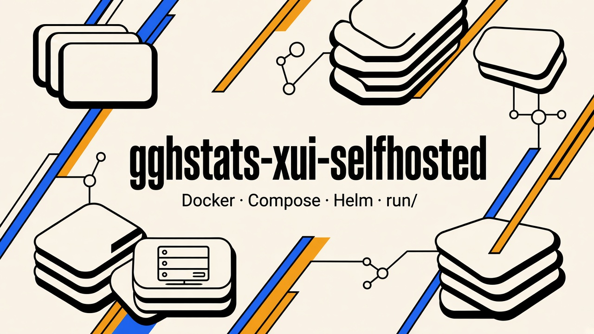

# gghstats-xui-selfhosted

[](https://github.com/hrodrig/gghstats-xui-selfhosted/releases)
[](https://opensource.org/licenses/MIT)
[](https://github.com/hrodrig/gghstats-xui/pkgs/container/gghstats-xui)
[](https://github.com/hrodrig/gghstats)



Deployment manifests for **[gghstats-xui](https://github.com/hrodrig/gghstats-xui)** — the Atlas Day/Night dashboard — running in front of a **[gghstats](https://github.com/hrodrig/gghstats)** instance in **API-only** mode.

**App source and releases:**
- Dashboard (BFF): [github.com/hrodrig/gghstats-xui](https://github.com/hrodrig/gghstats-xui)
- Backend (API): [github.com/hrodrig/gghstats](https://github.com/hrodrig/gghstats)

---

## Table of contents

- [Pick a path](#pick-a-path)
- [What this runs](#what-this-runs)
- [Quick start (Compose)](#quick-start-compose)
- [Docker single container](#docker-single-container)
- [Docker Compose minimal](#docker-compose-minimal)
- [Kubernetes Helm](#kubernetes-helm)
- [Persistent data and secrets](#persistent-data-and-secrets)
- [Repository layout](#repository-layout)
- [Versioning](#versioning)
- [Contributing](#contributing)
- [License](#license)

---

## Pick a path

| You want… | Section |
|-----------|---------|
| **Compose, two containers** (quick VPS / laptop) | [Quick start (Compose)](#quick-start-compose) |
| **UI only** against an existing gghstats | [Docker single container](#docker-single-container) |
| **Kubernetes** (Helm + route the UI yourself) | [Kubernetes Helm](#kubernetes-helm) |

Shared Compose env: copy [`run/common/.env.example`](run/common/.env.example) to **`${GGHSTATS_HOST_DATA}/.env`**. Deeper index: [`run/README.md`](run/README.md).

**[↑ Contents](#table-of-contents)**

---

## What this runs

Two containers on an internal Docker network:

| Container | Image | Role | Exposed |
|-----------|-------|------|---------|
| `gghstats` | `ghcr.io/hrodrig/gghstats:v1.6.6` | GitHub traffic backend, **API-only** (`GGHSTATS_API_ONLY=true`), SQLite in `/data` | ❌ internal only |
| `xui` | `ghcr.io/hrodrig/gghstats-xui:v0.1.0` | BFF + dashboard. Proxies `/api/*` → `http://gghstats:8080`, adds `x-api-token` | ✅ host port `3000` |

The **API token never reaches the browser** — it lives in both containers (`GGHSTATS_API_TOKEN`) and the xui BFF attaches it server-side on every proxied request.

> **Security note:** the xui BFF allowlists paths/methods and rejects path traversal, but it is **not** the deployment auth boundary. If the host is public, put it behind Cloudflare Access, reverse-proxy basic auth, or equivalent.

---

## Quick start (Compose)

```bash
git clone https://github.com/hrodrig/gghstats-xui-selfhosted.git
cd gghstats-xui-selfhosted
export GGHSTATS_HOST_DATA=/home/gghstats/gghstats-data
mkdir -p "$GGHSTATS_HOST_DATA"
cp run/common/.env.example "${GGHSTATS_HOST_DATA}/.env"
# Edit "${GGHSTATS_HOST_DATA}/.env": set GGHSTATS_GITHUB_TOKEN, GGHSTATS_API_TOKEN,
# and GGHSTATS_HOST_DATA (same absolute path as above).

docker compose --env-file "${GGHSTATS_HOST_DATA}/.env" -f run/docker-compose/minimal/docker-compose.yml up -d
```

**Check:** `curl -sS -o /dev/null -w '%{http_code}\n' http://127.0.0.1:3000/` → open **http://localhost:3000**.

**Remove:**

```bash
docker compose --env-file "${GGHSTATS_HOST_DATA}/.env" -f run/docker-compose/minimal/docker-compose.yml down
```

**[↑ Contents](#table-of-contents)**

---

## Docker single container

**Goal:** run **only the xui BFF** (the dashboard) against a gghstats instance you already run elsewhere.

```bash
docker run -d \
  -e GGHSTATS_API_BASE=https://your-gghstats.example.com \
  -e GGHSTATS_API_TOKEN=your-shared-token \
  -p 3000:3000 \
  --name gghstats-xui \
  ghcr.io/hrodrig/gghstats-xui:v0.1.0
```

`GGHSTATS_API_BASE` points at a gghstats `serve` instance; for API-only, that backend runs with `GGHSTATS_API_ONLY=true`, but a full dashboard backend also works — the xui only calls `/api/*` routes.

**Check:** `curl -sS -o /dev/null -w '%{http_code}\n' http://127.0.0.1:3000/`.

**More:** [run/docker/README.md](run/docker/README.md)

**[↑ Contents](#table-of-contents)**

---

## Docker Compose minimal

The default stack (two containers, internal network):

```bash
export GGHSTATS_HOST_DATA=/home/gghstats/gghstats-data
mkdir -p "$GGHSTATS_HOST_DATA"
cp run/common/.env.example "${GGHSTATS_HOST_DATA}/.env"
# Edit "${GGHSTATS_HOST_DATA}/.env": GGHSTATS_GITHUB_TOKEN, GGHSTATS_API_TOKEN, GGHSTATS_HOST_DATA

docker compose --env-file "${GGHSTATS_HOST_DATA}/.env" -f run/docker-compose/minimal/docker-compose.yml up -d
```

**More:** [run/docker-compose/minimal/README.md](run/docker-compose/minimal/README.md)

**[↑ Contents](#table-of-contents)**

---

## Kubernetes Helm

**Goal:** xui (BFF) on Kubernetes; optional in-cluster gghstats (API-only + PVC). Default = both. UI-only against a remote gghstats: `gghstats.enabled: false` + `xui.env.apiBase` (see [`values.ui-only.example.yaml`](run/kubernetes/examples/values.ui-only.example.yaml)).

**Chart scope:** workloads + ClusterIP only. **Out of scope:** Ingress / IngressRoute, DNS, TLS — you apply those yourself (examples below; keep edited copies outside this repo).

**Naming:** this repository is **`gghstats-xui-selfhosted`**. Chart path **`run/kubernetes/helm/gghstats-xui/`** — chart name **`gghstats-xui`**. Packages + [**`index.yaml`**](https://hrodrig.github.io/gghstats-xui-selfhosted/index.yaml) on GitHub Pages / [Releases](https://github.com/hrodrig/gghstats-xui-selfhosted/releases).

**Install** (personal files under **`~/gghstats-xui-selfhosted-data/`** — never in this clone):

```bash
helm repo add gghstats-xui https://hrodrig.github.io/gghstats-xui-selfhosted
helm repo update
# Secrets first — chart README step 2
mkdir -p ~/gghstats-xui-selfhosted-data
cp run/kubernetes/examples/values.example.yaml ~/gghstats-xui-selfhosted-data/values.yaml
# edit ~/gghstats-xui-selfhosted-data/values.yaml
helm upgrade --install my-xui gghstats-xui/gghstats-xui -n gghstats --create-namespace \
  -f ~/gghstats-xui-selfhosted-data/values.yaml
```

**Route the UI** (separate file, out of chart scope):

```bash
cp run/kubernetes/examples/traefik-ingressroute.yaml ~/gghstats-xui-selfhosted-data/traefik-ingressroute.yaml
# edit Host(`xui.example.com`), service <release>-gghstats-xui-ui, certResolver
kubectl apply -f ~/gghstats-xui-selfhosted-data/traefik-ingressroute.yaml
```

**Step-by-step:** [chart README](run/kubernetes/helm/gghstats-xui/README.md) · [examples](run/kubernetes/examples/)

**[↑ Contents](#table-of-contents)**

---

## Persistent data and secrets

Keep **SQLite** and **`${GGHSTATS_HOST_DATA}/.env`** in one host directory outside the clone (e.g. `/home/gghstats/gghstats-data/`). Set **`GGHSTATS_HOST_DATA`** inside the main **`.env`** to that absolute path, then run Compose with **`--env-file "${GGHSTATS_HOST_DATA}/.env"`**.

The `gghstats` container bind-mounts **`${GGHSTATS_HOST_DATA}`** to **`/data`**; its SQLite DB (`gghstats.db`) lives there. The `xui` container is stateless.

**[↑ Contents](#table-of-contents)**

---

## Repository layout

```text
assets/
└── gghstats-xui-selfhosted-hero.png
run/
├── common/.env.example          # Shared vars: gghstats (api-only) + xui (BFF)
├── docker/                      # docker run (xui-only BFF)
├── docker-compose/
│   └── minimal/                 # Two-container stack (gghstats + xui)
└── kubernetes/
    ├── examples/                # Traefik IngressRoute (beside the chart)
    └── helm/gghstats-xui/       # Helm chart: two Deployments + PVC + Secret
data/
└── .keep                        # Repo-root fallback mount target (see .env)
```

**[↑ Contents](#table-of-contents)**

---

## Versioning

- **[`VERSION`](VERSION)** — semver of **this repository** (manifests, docs, `run/`). On **`main`**, tag with **`v<semver>`**.
- **`GGHSTATS_VERSION`** in **`${GGHSTATS_HOST_DATA}/.env`** — the upstream **gghstats** backend image tag on GHCR (e.g. `v1.6.6`).
- **`GGHSTATS_XUI_VERSION`** in **`${GGHSTATS_HOST_DATA}/.env`** — the **gghstats-xui** dashboard image tag on GHCR (e.g. `v0.1.0`).

Three independent numbers. Upgrade the dashboard or backend by editing the matching env var, then **pull + `up -d`** (not `restart` alone, which does not swap images).

### Gitflow

Same mold as [gghstats-selfhosted](https://github.com/hrodrig/gghstats-selfhosted): topic branch → PR → `develop` → (ship) PR → `main` → annotated tag `v*`. Never push `develop`/`main` directly. No `uat`. See `make gitflow`, [AGENTS.md](AGENTS.md), and [CONTRIBUTING.md](CONTRIBUTING.md).

**CI:** PR → Helm lint + kubeconform (`.github/workflows/helm-lint.yml`). **Chart publish:** annotated tag **`v*`** on **`main`** → chart-releaser → **`gh-pages`** ([`index.yaml`](https://hrodrig.github.io/gghstats-xui-selfhosted/index.yaml)). One-time: **Settings → Pages → Source** = branch **`gh-pages`**, folder **`/`**.

**[↑ Contents](#table-of-contents)**

---

## Contributing

See [CONTRIBUTING.md](CONTRIBUTING.md), [CODE_OF_CONDUCT.md](CODE_OF_CONDUCT.md), and [SECURITY.md](SECURITY.md). Local gate: `make release-check`.

**[↑ Contents](#table-of-contents)**

---

## License

MIT — see [LICENSE](LICENSE).
